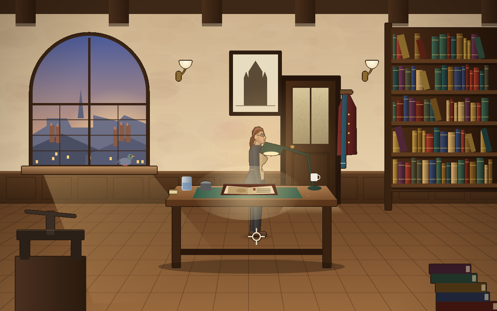

# amade-templar-game

**amade-templar-game**, *The Seal of the Templars*, is the point-and-click adventure of the [amadeOS](https://github.com/datazuul/amadeos) desktop. On the night of 12 October 1307, the squire Aimery has to get the last page of the Temple's accounts with the Crown out of the Paris Temple before the King's men arrive. Today, the book restorer Maria Vogt finds that page in the binding of a medieval psalter. With it she finds a debt the King of France never paid. The game has painted rooms, people drawn to real proportions, dialogues with choices and a notebook with hints. The history is true, and legends are called legends. It is built on [amade-game-engine](https://github.com/datazuul/amade-game-engine) and runs on other operating systems as well.




## Playing

- **Left button**: walk, use something, talk to someone, or go through a door.
- **Right button**: look at something.
- Move the pointer to the top of the screen to see the inventory. Click an item to take it in hand, then click on something in the room to use the item there, or on another item to combine the two. The right button puts the item back.
- In a dialog, click one of the lines at the bottom.
- **Esc** or **.** skips a line. **N** opens Maria's (or Aimery's) notebook with the next goal; press **N** again for a hint.
- **F5** saves, **F9** continues the saved game. The game also saves itself in every new room, and *Game → Continue Saved Game* picks up there.
- **F11** switches to full screen and back. *Game → Graphics* chooses **Direct** (the screen's full size) or **Pixels** (640 × 400, enlarged by whole factors). **F12** shows how long each frame takes.
- The sounds can be switched off under *Game → Sound*.

The whole story is there:

- **Prologue**, the Paris Temple in 1307: the treasurer's chamber, the courtyard and the library.
- **Act 1**, today's Paris: the restoration workshop, the reading room of the library, the Square du Temple and the Pont Neuf at night.
- **Act 2**, La Rochelle: a flashback to the prison cart at dawn, the old harbour, the Cour du Temple café, and a second flashback to the quay in fog.
- **Act 3**, the Convent of Christ at Tomar: the Charola, the archive in the tower and the cloister.
- **Epilogue**, "What really happened": what is history in the game and what was made up.

## Files

| What | Where |
|---|---|
| Settings (graphics, sound) | `~/.config/amadeos/templar/templar.properties` |
| Saved game | `~/.local/share/amadeos/games/templar/game.save` |

## Writing the story

The whole story is data in `src/main/resources/eu/amadeos/games/templar/`, read by the engine's `adventure` package:

- `story.txt` lists the rooms, who the player is in each (Aimery or Maria), the people and where they stand, and the script files.
- `rooms/<room>.txt` describes a room: its floor as a polygon with holes, the depth scale, named spots, the hotspots with the place to stand, the exits, and the layers people walk behind.
- `scripts/<file>.txt` say what happens: `on look psalter`, `on use bonefolder psalter`, `on talk lefort`, dialog `option`s, with commands like `say`, `walk`, `gain`, `set`, `show`, `goto`, `title`, `dialog`, and `if` … `else` … `end`.
- `messages*.properties` hold every sentence, in every language. Scripts only name text keys.

`StoryTest` checks that every text exists, that every door leads to a room and a spot, and that no two rooms share a hotspot name. `PlaythroughTest` plays the whole story with clicks, as a player would, so a puzzle that can't be solved fails the build.

The rooms are painted by code in `ui.art.rooms`, one class per room, at twice the logical size. Each object is drawn on its own layer with a dark ink outline. The people are drawn by `ui.art.Figure` from a `Look` (build, clothes, hair) and a `Pose`. They are seen from the side, the front and the back, and are tinted to each room's light.

## Building

```bash
./gradlew test          # the window test needs a display (xvfb-run on servers)
./gradlew run
./gradlew deb           # build/distributions/amade-templar-game_<version>_all.deb
./gradlew installToAmadeOs   # copies the package to ../amadeos/config/packages.chroot/
./gradlew shot -Proom=reading/workshop-door -Pargs="out.png 3 1 330 330"   # a picture of a room, for designing
```

All pictures are drawn with Java2D at run time. The icon is drawn by `tools/MakeIcon.java`. `./gradlew screenshots -Pshots=<folder>` draws the handbook's screenshots.

With `../amade-game-engine` (and `../amade-commons`) checked out next to this repository, Gradle builds those checkouts instead of the JitPack versions.

## Structure

- `domain`:
  - `Story` reads the story, its rooms, people and scripts.
  - `Adventure` is a game being played. It turns clicks into walking and scripts, handles lines, titles and fades, the people of each room, the item in hand and saving.
- `repository`: `TemplarSettings` (graphics, sound).
- `ui.art`:
  - `Figure`, `Look`, `Pose`, `Cast` and `Sprites` draw the people. `Animals` draws the cat and the pigeons, `Items` the inventory pictures.
  - `TitleArt` draws the title screen. `Brush` and `Ink` are the painting helpers.
  - `rooms` has one painter per room, plus `Lights`.
- `ui.game`:
  - `TemplarGame` runs the game on the loop thread, with the title, play and end scenes.
  - `RoomView` draws a room with its people in depth order. `Hud` draws the inventory bar, labels, dialog choices, speech, title cards and the pointer.
  - Also here: `Notebook`, `Gallery` (paints the rooms in the background), `SoundBank` and `Arena`.
- `ui.main`: Model-View-Presenter around the game: `TemplarPresenter`, `TemplarView`, `TemplarWindow`.

From the engine: `WalkArea`, `DepthScale`, `Actor`, `Hotspot`, `Room`, `Script`, `ScriptRunner`, `Flags`, `Inventory`, `Interaction`, `SpokenText` (the `adventure` package), plus `TextData`, `SaveFile`, `GameLoop`, `GameCanvas`, `Mouse`, `Keyboard`, `Mixer`, `SceneStack`, `FullScreen`.

Comments of the form `// --8<-- [start:name]` mark the excerpts that the [Game Developer's Handbook](https://datazuul.github.io/amade-game-engine/) quotes. Chapter 50, the first chapter of Part V "Stories", is about this game.

## Licence

[EUPL-1.2](LICENSE)
